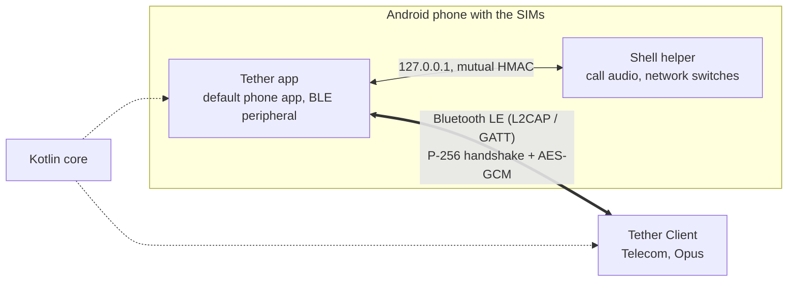

<p align="center">
  
</p>

<h1 align="center">Tether</h1>

<p align="center"><b>Your Android phone's calls, texts, contacts and call history on a second Android phone, over an
end-to-end encrypted Bluetooth link. No server, no account.</b></p>

<p align="center">
  
  
  <a href="docs/SDK-kotlin.md"></a>
  
</p>

<p align="center">
  <a href="docs/INSTALL.md">Install guide</a> ·
  <a href="docs/FAQ.md">FAQ</a> ·
  <a href="docs/fa/README.md">فارسی</a> ·
  <a href="#documentation">Docs</a> ·
  <a href="CONTRIBUTING.md">Contribute</a>
</p>

## What it is, and why

Carry two SIMs but only want one phone in your hand? Tether makes an Android phone the SIM holder: it stays in a bag
and becomes the default phone app, while a second Android phone in your hand rings, dials, texts and shows your
contacts and history. The phones talk directly over Bluetooth LE, every session is end-to-end encrypted with keys
exchanged by a QR code, and nothing goes through a server or an account.

This fork is Android only. It has two apps:

| App | Module | Install it on |
| --- | --- | --- |
| **Tether** (`app.tether.android`) | `android/app`, `android/helper` | **The Android phone with the SIM cards** (Android 8+). It becomes the default phone app |
| **Tether Client** (`app.tether.client`) | `android/client` | **The Android phone in your hand** (Android 10+) |

Both share the Kotlin core (`android/core`: protocol, crypto, records, Opus), which is also usable on its own as a
JVM library ([Kotlin SDK](docs/SDK-kotlin.md)).

## What works

- **Calls** through Android's own call system on the client (Bluetooth headsets and the car included): incoming
  ringing, answer, decline, dial, hang up, hold, mute, keypad tones, speaker, call waiting, "move the call here"
  between devices. Call audio is bridged both ways (Opus, wideband) on SIM phones that allow it, see
  [Compatibility](#compatibility).
- **Numbers from other apps**: "Call with Tether Client" for `tel:` links.
- **Messages** (SMS): every conversation, live new texts, send from either SIM, read state shared with the SIM phone,
  delete, mute, block, an outbox while out of reach.
- **Contacts**: browse, search, edit, add, favourites; **Recents**: search, delete, clear, missed-call badge.
- **Notifications** for texts and missed calls, with quick reply.
- **Link screen**: battery and signal of each SIM, and remote switches for mobile data, the data SIM, Wi-Fi hotspot,
  Bluetooth tethering, airplane mode, network mode, and "Share VPN".
- English and Persian (right to left), in a dark design.

More on the client: [docs/ANDROID-CLIENT.md](docs/ANDROID-CLIENT.md).

## How it fits together



More in [docs/ARCHITECTURE.md](docs/ARCHITECTURE.md); the wire format is [protocol/PROTOCOL.md](protocol/PROTOCOL.md).

## What you need

| | |
| --- | --- |
| SIM phone | Android 8.0 or later with Bluetooth LE advertising (Android 8–9 link over GATT only). Call audio needs Android 11 or later (full support on 13+) and a build that lets the shell user capture call audio; see [features by Android version](docs/devices/android-versions.md). Tether becomes its default phone app. |
| Client phone | Android 10 or later with Bluetooth LE. |
| To build | JDK 17 and the Android SDK. |

## Quick start

```bash
cd android
./gradlew :app:assembleRelease :client:assembleRelease
adb -s <SIM phone> install -r app/build/outputs/apk/release/app-release.apk
adb -s <client phone> install -r client/build/outputs/apk/release/client-release.apk
```

Then follow [docs/SETUP.md](docs/SETUP.md): open Tether on the SIM phone, grant what it asks, make it the default
phone app, pair Wireless debugging for call audio, and scan its QR code from Tether Client (Link › Pair).

## Documentation

| | |
| --- | --- |
| [INSTALL.md](docs/INSTALL.md) · [FAQ.md](docs/FAQ.md) · [فارسی](docs/fa/README.md) | Install, first call; common questions |
| [BUILD.md](docs/BUILD.md) | Building and installing the apps |
| [SETUP.md](docs/SETUP.md) | First run on both phones, permissions, Wireless debugging, pairing, the Link switches |
| [USAGE.md](docs/USAGE.md) | Calls, messages, contacts, internet sharing, Share VPN, notifications |
| [ANDROID-CLIENT.md](docs/ANDROID-CLIENT.md) | The Android client: what it does, building, first run, tests |
| [TROUBLESHOOTING.md](docs/TROUBLESHOOTING.md) | Not linking, no audio, helper not starting, which logs to collect |
| [ARCHITECTURE.md](docs/ARCHITECTURE.md) | How the parts fit together; the wire protocol is in [protocol/PROTOCOL.md](protocol/PROTOCOL.md) |
| [TESTING.md](docs/TESTING.md) | The automatic tests, the one-command runner, on-device checks |
| [SDK-kotlin.md](docs/SDK-kotlin.md) · [EXTENDING.md](docs/EXTENDING.md) | The Kotlin library; protocol extensions |
| [RELEASING.md](docs/RELEASING.md) · [ROADMAP.md](docs/ROADMAP.md) | Releases; what comes next |
| [SECURITY.md](SECURITY.md) | Threat model and reporting a vulnerability |

Some guides in `docs/` still describe the iPhone app of the upstream project; the iPhone app is not part of this fork.

## Compatibility

Tested on one pair only. Everything else is expected from the Android and iOS APIs used, not tried: please report
what you see (open an issue with your phone model, Android version and the Link log).

| Device / feature | Status |
| --- | --- |
| Samsung Galaxy A54, Android 17 (One UI) as the SIM phone | **Tested** upstream (with an iPhone client), including call audio |
| Tether Client on a second Android phone | Tested on the JVM against a simulated SIM phone; not yet on a second phone |
| Redmi Note 8 (Qualcomm, custom Android 16) + iPhone 17 Pro (user report, #18) | Calls, texts and call audio work (uplink injected via in-call music `telephony_tx`; phone's microphone stays on) |
| Other Samsung phones, Android 13+ | Expected to work like the A54, including taking the phone's own microphone and earpiece out of a bridged call (redirect audio mode, checked during each call; see [Troubleshooting](docs/TROUBLESHOOTING.md#the-other-side-cannot-hear-me)) |
| Other Android 13+ phones | Calls, messages, contacts and switches expected to work. Call audio works only if the build lets the shell user use the call-audio interception API; the phone's own earpiece is muted during a bridged call (voice-call stream, or each vendor's own audio controls; from their sources, untested on devices; the Link tab shows "Android phone silent"); its microphone is taken out of the call with Android's redirect audio mode where the phone allows it (checked during each call and by the self-test), else it stays on |
| Samsung Galaxy A73 5G, Android 16 (user report, #13) | Calls, texts, switches and two-way call audio work (since 1.2.4, via `capture:intercept` and `inject:telephony_tx`); silencing the A73's own earpiece during a call is still open |
| Android 11-12 | Everything, with call audio on a best-effort path (voice-call capture); untested |
| Android 10 | Everything except call audio; the helper needs the TCP adb path; untested |
| Android 8-9 | Everything except call audio; link over GATT only; the helper only via TCP adb; tested in the emulator, untested on devices |
| Single-SIM phones | Expected to work; SIM choices are hidden |
| Phones without Wi-Fi hotspot or Bluetooth tethering | Those switches are hidden |
| Bluetooth tethering between the same two phones | Works; the link then runs over its GATT transport (see [TROUBLESHOOTING.md](docs/TROUBLESHOOTING.md)) |

Device notes for the test phone, and how to check your own: [docs/devices/galaxy-a54.md](docs/devices/galaxy-a54.md).

## Security in brief

Pairing is a one-time QR code that carries the Android phone's public key and a short-lived token. Every session
starts with a P-256 key agreement that authenticates both sides; everything after it is encrypted with AES-GCM.
Bluetooth's own pairing is not used or trusted. Nothing leaves the two devices. Details and the threat model:
[SECURITY.md](SECURITY.md).

## Limits

- One client per SIM phone is the tested setup; several can be paired (protocol §5.1).
- Bluetooth range: the phones need to stay within a few metres.
- MMS, RCS, group messages, video calls and visual voicemail are not supported.

## Legal

Use Tether only with your own phones and SIM cards, and follow your local law on recording and handling calls and
messages. Tether does not record calls.

## Contributing

Compatibility reports from phones other than the tested pair are the most useful help right now
([device report](https://github.com/amirwmr/tether/issues/new?template=device_report.yml)). Code, docs and
translations are welcome too: start with [CONTRIBUTING.md](CONTRIBUTING.md) and issues labelled
[good first issue](https://github.com/amirwmr/tether/labels/good%20first%20issue). Everyone taking part follows the
[Code of Conduct](CODE_OF_CONDUCT.md).

## Community and support

Questions go to [a question issue](https://github.com/amirwmr/tether/issues/new?template=question.yml) (after the [FAQ](docs/FAQ.md)), ideas and bugs to
[Issues](https://github.com/amirwmr/tether/issues/new/choose); see [SUPPORT.md](SUPPORT.md) for what to include.
Security problems: privately, as described in [SECURITY.md](SECURITY.md).

## License

MIT, see [LICENSE](LICENSE). Third-party components and their licences: [NOTICE](NOTICE).

## Star history

<a href="https://star-history.com/#amirwmr/tether&Date"></a>
